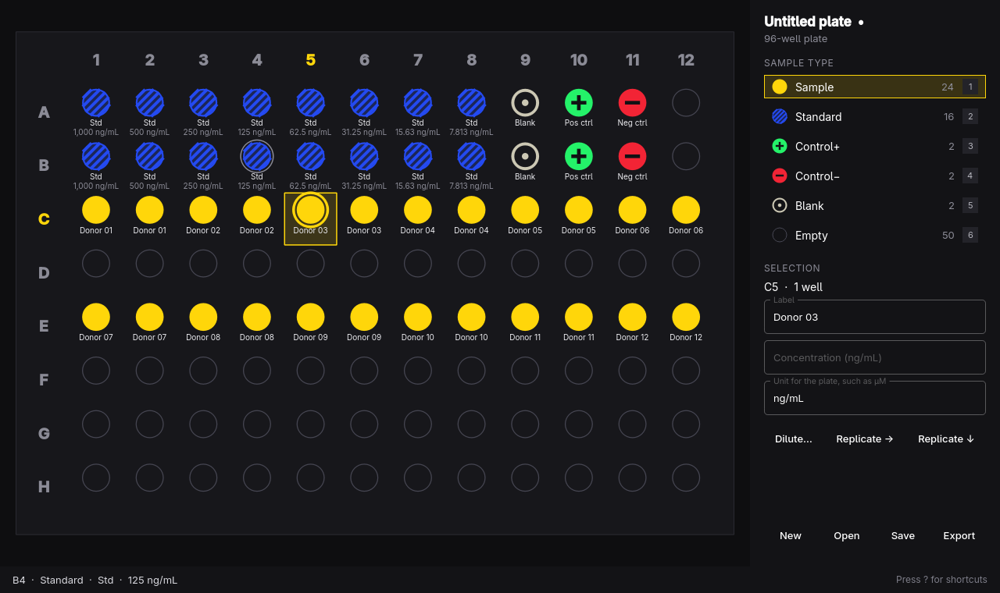

# Plate

Design a microplate layout and export it for a plate reader or liquid handler.



Plate does one job. Lay out a 96-well (8 × 12) or 384-well (16 × 24) plate:
samples, standards, positive and negative controls, blanks. Give wells labels
and concentrations, then export:

- **CSV** with `Well,Type,Label,Concentration` for every well, for plate readers
  and liquid handlers.
- **SVG** or **PDF**: a printable plate map with a legend. The window and both
  exports are drawn by the same C++ painter, so what you print is what you saw.

Every sample type has its own color, taken from the Omarchy accent where it
can be, and its own pattern, so the map reads in grayscale too:

| Type | Pattern |
| --- | --- |
| Sample | solid |
| Standard | diagonal stripes |
| Control+ | plus |
| Control− | minus |
| Blank | ring with a center dot |
| Empty | outline |

Plate follows the Omarchy theme, window rounding, and language live.

## Keys

| Key | Action |
| --- | --- |
| `1` – `6` | Pick the sample type |
| Arrow keys | Move the cursor |
| Shift + arrow keys | Extend the selection |
| `Space` | Assign the type to the selection |
| Click | Assign the type to a well |
| Drag | Fill a rectangle |
| Shift + drag | Fill whole rows (drag sideways) or columns (drag up or down) |
| Ctrl + drag, or right drag | Select without assigning |
| `Esc` | Select just the cursor's well |
| `L` | Label the selection |
| `C` | Set the selection's concentration |
| `D` | Serial dilution across the selection: start, factor, direction |
| `R` | Replicate the selection into the wells to its right |
| Shift + `R` | Replicate the selection into the wells below |
| Ctrl + `Z` / Ctrl + Shift + `Z` | Undo / redo |
| Ctrl + `N` | New plate (96 or 384 wells) |
| Ctrl + `O` | Open |
| Ctrl + `S` / Ctrl + Shift + `S` | Save / save as |
| Ctrl + `E` | Export CSV, SVG, or PDF |
| `?` | Show every shortcut |
| `Q` | Quit (asks first when there are unsaved changes) |

Hovering a well shows its type, label, and concentration in the status line.
A replicate becomes the new selection, so pressing `R` twice makes triplicates.

## The .plate file

Layouts are saved as JSON, written atomically (beside the target, then renamed
over it):

```json
{
  "format": "plate",
  "version": 1,
  "rows": 8,
  "columns": 12,
  "unit": "ng/mL",
  "wells": [
    { "well": "A1", "type": "standard", "label": "Std", "concentration": 1000 },
    { "well": "A9", "type": "blank", "label": "Blank" },
    { "well": "C1", "type": "sample", "label": "Donor 01" }
  ]
}
```

Types are `sample`, `standard`, `control+`, `control-`, `blank`, and `empty`.
Wells left out are empty.

## Command line

Every command except `open` runs without a display, takes `--json`, exits 0 or
1, and writes errors to stderr.

```sh
plate open [file]                          # the window
plate new assay.plate --wells 384 --unit µM
plate check assay.plate --json             # every problem, with its well
plate export assay.plate --csv assay.csv --svg map.svg --pdf map.pdf --json
plate skill install                        # an agent skill for coding agents
```

`plate skill install` writes the skill to `~/.agents/skills/plate` and links it
into `~/.claude/skills`, so coding agents can write and check layouts.

## Build

Plate is C++ and Qt Quick, built with `qmake6` and `make`. Everything it needs
ships with Omarchy.

```sh
bin/build      # build/plate
bin/test       # the Qt Test suite, offscreen
bin/install    # makepkg -fsi: the binary, launcher entry, icon, and .plate file type
```

## License

MIT. The theme watcher, translator, portal file picker, and command line
follow Omacut, Monologue, and Hype by David Heinemeier Hansson (MIT).
